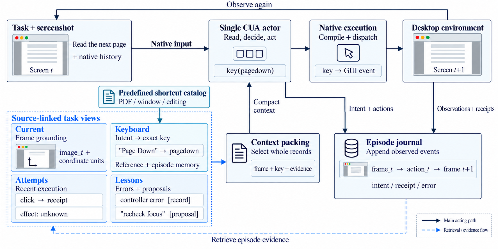

# TaskViews



*首图展示历史 Mini v3 核心（`0a5b6f2`）：四类 View 从预置操作知识和本次任务的执行记录中组织补充上下文。当前开发版在此基础上增加了指导选择、阶段状态和跨 View 引用。*

TaskViews 为 computer-use agent 按信息职责组织上下文：让基础操作知识、当前界面、已执行尝试和历史错误各有位置，帮助同一个 CUA actor 复用证据、选择下一步动作。Mini 路径采用确定性的检索与打包，正常操作中不增加规划或分析模型调用。

## 开发状态与已知问题

**当前优化版 keyboard 尚未完全优化完毕，在 agent 决策过程中仍可能出现错误匹配的 bug**，例如将界面状态误判为动作意图，或选入与当前软件、对象、流程阶段不适用的操作卡。主要代码与指导内容如下：

|代码路径|职责|
|---|---|
|[`kobe_views/keyboard_guidance.py`](kobe_views/keyboard_guidance.py#L207)|`route()`：根据任务、公开意图、执行记录和流程阶段选择操作卡|
|[`kobe_views/guidance_semantics.py`](kobe_views/guidance_semantics.py#L78)|区分动作意图、界面状态及能力需求|
|[`kobe_views/guidance_eligibility.py`](kobe_views/guidance_eligibility.py)|检查操作、对象和软件等适用条件|
|[`kobe_views/key_tools/guidance.json`](kobe_views/key_tools/guidance.json) · [`catalog.json`](kobe_views/key_tools/catalog.json)|完整操作卡与分类按键配方|
|[`kobe_views/keyboard_view.py`](kobe_views/keyboard_view.py#L56)|旧目录路径的主题选择与 lookup；历史实验按各自冻结版本运行|

当前开发版已[移除 `focus.verify` 无匹配回退卡](docs/taskviews-mini-optional-keyboard-v8.md)，并接入[同一 actor 的五阶段流程](docs/taskviews-mini-five-stage-v9.md)：先结合 Current、Lessons 与 Attempts 判断路线，按需通过 `keyboard_lookup` 补充具体操作知识，再构建原生命令。没有适用指导仍可直接决策。每步最多一次可选知识往返，共用原时间和 token 预算；尚无新的在线性能结论。

Keyboard 当前采用[操作知识边界 v11](docs/taskviews-mini-operation-knowledge-v11.md)：保留分层选择，移除核验、泛化截图／导出、图像编辑和拖拽提示卡。结果核验由 Current 与执行反馈承担；空结果直接呈现空 Keyboard，不生成 `no_match` 卡片状态。`when` 和目录 `check` 不再送入操作卡，也不计为知识覆盖；方法覆盖须有明确的主操作契约。

**Graph 模式也尚未开发完毕，keyboard 的优化仍是当前未完成的前置工作。** 表中 Graph 测试数值包含当时 keyboard 匹配及有效指导送达缺陷的干扰，不能据此单独归因 Graph／links 的收益。当前只实现了部分身份、共享事实与引用组织；linked 尚未包含完整图检索或路径规划。历史实验使用各自冻结的 keyboard，不等于当前优化候选已经完成验证。

## 工作方式

```text
任务 + 当前截图 + 原生历史 + 本轮 View 补充包
                         ↓
                   单一 CUA actor
                         ↓
               原生工具 → 官方执行器 → 桌面
                         ↓
               观察 / 参数 / 回执 / 错误
                         ↓
                 episode SQLite journal
                         ↓
                 下一轮检索与上下文打包
```

|View|提供的信息|证据边界|
|---|---|---|
|`current`|当前观察、任务和坐标约定；开发版还投影已有检查状态|引用当前帧，不额外生成界面事实|
|`keyboard`|适用的准确按键、完整操作指导及同 episode 按键记录|目录启用不代表软件、窗口或焦点已确认|
|`attempts`|实际动作参数、回执，以及动作前后和后续观察|工具返回、按键匹配或截图变化不等于业务成功|
|`lessons`|真实执行错误，以及带来源的模型公开意图／复核报告|模型判断保留 proposal 身份，`unknown` 不自动升级|

四个 View 共用 **3000 UTF-8 bytes** 补充上下文上限，并受实际请求余量约束。完整记录按预算准入，完整事件、来源和省略信息留在本地审计中。补充包每轮独立可读；任务记录按 episode 隔离。

项目沿用 UI-KOBE 的执行转移记录和检索思路，将其组织为固定职责的 View。GUI 动作仍经共同的 native 协议桥接与外部 OSWorld 执行／评分底座处理。模型声称完成和官方评分分别记录。

## 已观察到的效率与限制

以下按**任务类型 × reasoning**分表。**所有列出的 TaskViews 实验官方得分均为 1，且决策次数、总 tokens 均低于同任务、同 reasoning 的 LLM baseline。** 表中的 baseline 也均为官方 1 分，作为对照单独列示。

模型均为 `qwen3.8-max`，thinking 开启，温度 0，最多 40 次决策；逐组核对相同任务、reasoning 与预算。**总 tokens＝输入＋输出**；输出已包含推理 tokens，不再重复相加。这里只展示满足上述条件的结果，完整实验及未改善组保留在[实验总账](docs/taskviews-post-v7-experiments-20261029.md)。

### 发票 · high

|实验组|冻结代码身份|决策次数|总 tokens|
|---|---|---:|---:|
|**LLM baseline**|`0eff232`|**40**|**342,438**|
|Mini v3|`e5451c8`|26|251,906|

### 发票 · low

|实验组|冻结代码身份|决策次数|总 tokens|
|---|---|---:|---:|
|**LLM baseline**|`0a5b6f2`|**28**|**226,864**|
|Mini v3|`0a5b6f2`|22|196,880|

### GIMP · high

|实验组|冻结代码身份|决策次数|总 tokens|
|---|---|---:|---:|
|**LLM baseline**|`4dd4f2b`|**28**|**≥234,386**|
|Graph r007 flat|`6d9e0d7`＋r007 冻结 manifest †|19|176,005|
|Graph r007 legacy|`6d9e0d7`＋r007 冻结 manifest †|19|183,268|

该 baseline 有一次请求缺少 usage，234,386 是已知下界；两组实验的完整总量均低于此下界，因此可以确认总 tokens 减少。

### GIMP · low

|实验组|冻结代码身份|决策次数|总 tokens|
|---|---|---:|---:|
|**LLM baseline**|`f277ea7`，TaskViews 关闭|**40**|**281,352**|
|Graph r007 flat|`6d9e0d7`＋r007 冻结 manifest †|20|152,553|
|能力指导 v3 legacy／full|`216a14e`|24|209,408|

### VLC · high

|实验组|冻结代码身份|决策次数|总 tokens|
|---|---|---:|---:|
|**LLM baseline**|`4dd4f2b`|**13**|**93,961**|
|Mini v7|`ae27018`|9|78,087|
|Graph r007 legacy|`6d9e0d7`＋r007 冻结 manifest †|10|88,842|

† Graph r007 当时冻结了基础提交及额外修改的源码 manifest，没有独立的完整实验 commit；不能仅检出 `6d9e0d7` 就声称复现 r007。逐格来源与哈希见[结构化总账](validation/taskviews-post-v7-experiments-20261029.json)。表中的“能力指导 v3”是后续模块版本，不是历史 Mini v3。

完整版本、指标定义、失败用量下界和后续实验见[实验与版本总账](docs/taskviews-post-v7-experiments-20261029.md)。不同提交、reasoning、目录和运行日期分别报告，不把离线结构验证当作在线成功率提升。

## 历史实现与当前开发版

|版本|范围|
|---|---|
|历史 Mini v3 / `0a5b6f2`|`mini_keyboard_memory_v3`；单 actor、四个 View、预置按键与 episode 记忆。保留原样，作为冻结参照。|
|历史 Mini v7 / `ae27018`|增加产物报告协议、来源校验、短纠错及同轮输入重新准入。不同于当前指导模块的“v7”。|
|当前 `main`|代码核心提交 `3800520`，后续提交补充报告与文档；包含阶段化复核、阅读进度、适用性优先的操作指导及三种 View 表示。最新指导候选有离线验证，尚无对应线上任务成绩。|

当前开发版支持以下表示方式，选择模式并不等于切换到某个历史提交：

|`--mini-graph-mode`|行为|
|---|---|
|`legacy`|原四 View 的表示／打包路径；仍使用所冻结提交的公共 actor 和指导模块|
|`flat`|统一实体 ID、共享事实与 View 引用，不输出新增显式关系|
|`linked`|与 flat 使用相同事实选择，额外输出有执行字段依据的关系|

flat／linked 在相同日志输入和预算下按 linked 成本选择相同事实；flat 删除关系后不回填记录。**linked 当前没有完整图检索或路径规划**，不应把关系输出本身当作已验证的效率优化。新入口默认显式选择 linked；旧计划缺少模式字段时解释为 legacy，恢复时不允许切换。

当前指导路径先检查能力、动作、对象、应用与流程阶段是否适用，再排序和打包完整指导组。软件名匹配、通用能力冻结与任务级联网调研是不同选项；联网调研默认关闭，其 API 成本另计。目录扩充和指导改写不保证比原 v3 更高效。

## 开始使用

Python **3.10+**。以下命令安装代码并预览确定性的目录选择，不启动 CUA、虚拟机或模型请求：

```bash
git clone https://github.com/H-Dw/TaskViews.git
cd TaskViews
python -m venv .venv
# Linux / WSL
source .venv/bin/activate
# Windows PowerShell 可改用 .venv\Scripts\Activate.ps1
python -m pip install -e ".[native,dev]"
python -m kobe_views.keyboard_selection \
  --keyboard-mode task_capabilities \
  --instruction "Read and compare PDF documents"
```

检出历史 Mini v3 源码：

```bash
git switch --detach 0a5b6f2
```

历史版本没有后续新增的命令参数，应按该提交自己的代码与冻结配置使用。返回开发版用 `git switch main`。

实际 OSWorld 评估需要另外准备 Linux／WSL、Docker／KVM、guest 镜像、任务资源和外部执行底座。项目固定使用 `xlang-ai/OSWorld-V2@3d778a3c9a34a079316f70df023b166700445792` 的执行／评分代码，并校验来源；仓库不附带 VM 镜像、任务答案、凭据或完整原始运行数据。

当前 Verified 入口为 `scripts/verified_invoice.py`，支持发票、GIMP、VLC。默认 API 为 AutoDL 的 `https://www.autodl.art/api/v1`，模型 `Qwen3.5-397B-A17B`，密钥由 `AUTODL_API_KEY` 环境变量提供。**上面的历史成绩使用 SX 接口的 `qwen3.8-max`，不是 AutoDL 成绩。** 模型、reasoning、坐标、预算、按键目录、源码身份和模式都应在新计划中显式冻结；准备、检查、启动和恢复按对应说明执行。

## 表中实验版本的差异

Mini v3／v7 是历史整体实现；legacy／flat 是 View 表示模式；能力指导 v3 是后续指导模块版本。运行身份由冻结源码、按键目录、模式和复核配置共同确定，不能仅凭一个名称比较。

|实验版本|按键指导与选择|View 内容与打包|复核与恢复|
|---|---|---|---|
|**Mini v3**／`e5451c8`、`0a5b6f2`|内置 5 个主题、11 条配方；依据最近两条公开意图选题；文件转移包含剪切、进入目标目录、粘贴的完整流程|原四 View；当前事实、真实错误和按键指导优先于普通历史；同 episode 按键记忆|没有强制 `artifact_review`；保留原生工具协议校验、执行日志与官方评分|
|**Mini v7**／`ae27018`|外部分类目录；依据最新公开意图及 lookup 选题，无匹配可为空；表中历史 VLC 实验实际仅启用 general|原四 View，增加主动动作的前后／后续观察、同任务过滤和产物检查；复核等内容优先于 keyboard|增加结构化产物报告及真实观察引用校验；报告错误短纠错，与原生错误分流，同轮按完整旧轮重新准入|
|**Graph r007 legacy**／基础提交＋r007 manifest|沿用当时的分类目录与选题；软件目录须冻结启用，启用不代表已送达或焦点正确|保留原四 View 记录式输出，不采用 flat 的共享节点与 View 引用结构；使用 r007 的公共 actor 和证据选择|保留严格终态校验与有界纠错；修正观察编号模板的字符串／整数冲突|
|**Graph r007 flat**／基础提交＋r007 manifest|与同轮 legacy 使用相同冻结目录配置和公共选题实现|统一实体 ID、共享事实及 View 引用；不输出新增显式 links；按 linked 成本选事实，删去关系后不回填|与同轮 legacy 共用终态校验和纠错实现；flat 不是旧 Mini v3，也没有图路径规划|
|**能力指导 v3 legacy／full**／`216a14e`|任务能力与辅助目录冻结；自动检索当前阶段指导；完整组区分依赖与替代方案，lookup 为补充入口|四 View 记录式输出；新增具体动作／循环反馈、带来源的短阅读 proposal；整组接纳或省略，保持 3000 bytes 上限|保留严格终态校验；本表采用 full 提示，正常轮次展示完整协议；与 compact 对照按同一完整成本选择事实，压缩空间不回填|

上述版本均沿用同一类原生 CUA 执行路径。legacy 只规定表示方式，不会撤销所选提交中的指导、公共提示、复核或审计改动。后续 legacy 成绩不能标成原 Mini v3 的重跑成绩。详细沿革见[版本总账](docs/taskviews-post-v7-experiments-20261029.md)。

## 来源与许可

本项目衍生自 [UI-KOBE](https://github.com/YuxiangChai/UI-KOBE)，保留原作者署名、[上游 README](README.upstream.md) 和 Apache-2.0 [LICENSE](LICENSE)。衍生源码与外部 OSWorld 底座的边界见 [UPSTREAM.md](UPSTREAM.md)。

## 文档与复现

|内容|入口|
|---|---|
|架构图与上传报告的来源|[README 来源说明](docs/readme-provenance.md)|
|v7 之后的冻结版本与逐格 performance|[实验总账](docs/taskviews-post-v7-experiments-20261029.md) · [CSV](validation/taskviews-post-v7-experiments-20261029.csv) · [JSON](validation/taskviews-post-v7-experiments-20261029.json)|
|Mini 实现与早期沿革|[Mini 说明](docs/taskviews-mini.md)|
|Graph 三模式与消融边界|[Graph v1](docs/taskviews-mini-graph-v1.md) · [送达 v2](docs/taskviews-mini-delivery-v2.md)|
|阶段上下文与当前按键适用性|[指导 v5](docs/taskviews-mini-guidance-v5.md) · [适用性审计](docs/taskviews-keyboard-eligibility-v7-audit.md)|
|按键目录与可选联网研究|[目录入口](tools/keyboard/README.md) · [目录选择](docs/taskviews-keyboard-auto-selection-20261020.md) · [任务级调研](docs/task-keyboard-web-research-20261020.md)|
|AutoDL 配置与离线／真实接口验证边界|[API 接入](docs/autodl-taskviews-mini-20261021.md)|
|冻结矩阵、串行执行与审计|[三任务运行说明](docs/osworld-mini-graph-high-low40.md)|

历史文档保留当时的默认值和验证结果；复现应以目标提交、该次冻结计划和原始指标来源为准。离线测试、接口探针和正式任务成绩分别核算。
