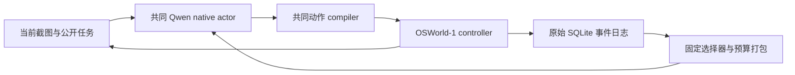

# OSWorld-Verified 发票与流水核对：搭建说明

本次交付只准备评测代码、官方源码、素材、镜像和离线验证证据。正式评测待用户审阅后启动，没有新任务成绩。

## 任务与现有代码审查

任务为 `multi_apps/337d318b-aa07-4f4f-b763-89d9a2dd013f`，公开要求是核对发票和银行流水，将不匹配发票归入 `problematic` 文件夹。官方配置提供四份 PDF，使用 `compare_pdfs` 评分。官方来源：[任务配置](https://github.com/xlang-ai/OSWorld/blob/b138d348256078fa634fc3b73567a7337c793e6b/evaluation_examples/examples/multi_apps/337d318b-aa07-4f4f-b763-89d9a2dd013f.json)、[OSWorld-Verified 说明](https://xlang.ai/blog/osworld-verified)。

审查时，当前 `OSWorld-K3-TaskViews` 已在 `mini` 分支，同时具有 `QwenTransitionNativeAgent` 和 `QwenMiniTaskViewsNativeAgent`。两者能够处理截图与 native computer-use 动作，但既有 `osworld_native_experiment.py` 的 Qwen 路径限定 OSWorld 2 Task059，因此不能直接启动本任务。现有磁盘镜像也是 OSWorld 2 镜像。`UI-KOBE-TaskViews` 是带大量既有改动的历史目录；此次新增入口放在当前 Mini 仓库，两组使用其中的共同 actor 与各自记忆实现。

新增的 `scripts/verified_invoice.py` 独立支持本任务，没有放宽旧 Task059 入口，也不接入其旧 episode 或检查点。

## 冻结配置

| 项目 | 本次设置 |
| --- | --- |
| 顺序 | UI-KOBE-like → TaskViews-mini；各一个独立 episode |
| 最大轮数 | 每组最多 35 次 `actor.predict`；空动作也占一轮 |
| 模型 | `qwen3.8-max` |
| 推理 | `reasoning_effort=low`，`enable_thinking=true`，`preserve_thinking=true` |
| 传输 | 现有 `qwen-sse-low-total16k` profile；SSE native tools；保留原始流、工具 ID 和 usage |
| 输出与重试 | 单次 `max_completion_tokens=16000`，每决策输出池 32000；现有两次语义修复与有界传输重试 |
| 采样 | temperature 0、top_p 0.9 |
| 截图与坐标 | absolute，模型截图 1920×1080 |
| 历史 | history 20、image 1、fold 1；32000 文本字符上限 |
| 官方执行 | OSWorld-1 `lib_run_single.run_single_example`、`DesktopEnv.step/reset/evaluate` |
| 评分 | 模型显式终止或达到 35 轮后调用原始评分；异常保留为异常，不填造 0 分 |
| 隔离 | 每组新进程、新 Docker 可写层、新 actor、新 SQLite journal |
| 附加功能 | 完整 TaskViews 角色链关闭；controls 扩展关闭；本入口无检查点恢复或自动重跑 |
| 资源 | guest RAM 2 GiB；VM 容器 3 GiB；运行进程 2 GiB；零 swap；单个 guest |

“35 轮”不是 35 次鼠标/键盘调用，也不是 35 次重复实验。一个决策可生成一个完整动作批次；API 修复和网络重试单独记账。此配置属于指定 35 决策预算的实验，不能直接称为公开榜单同条件复现。

## 源码、依赖和镜像

OSWorld-1 checkout 位于 WSL 的 `/home/dawei/osworld-verified/OSWorld`，固定 `b138d348256078fa634fc3b73567a7337c793e6b`。任务、DesktopEnv、setup、controller、runner、PDF metric 与 getters 均读取该 checkout 的原始文件。

共同 actor 的 prompt、截图处理、native→PyAutoGUI compiler 继续来自已有的 OSWorld-V2 `3d778a3c9a34a079316f70df023b166700445792`。这是明确记录的 actor 依赖，不把 V2 的任务、环境或评分器混入 OSWorld-1。`verified_runtime.py` 单独指定这两个来源，并校验原始文件哈希。

OSWorld-1 默认导入所有 metrics 时会要求未安装的 `easyocr`。本入口使用任务专用 registry，只注册原始 `compare_pdfs`、`get_vm_file`、`get_cloud_file`，直接导入它们所在的上游模块；没有复制、重写或替换评分函数。其它任务不能通过此 registry 运行。运行复用已有 Python 3.12 虚拟环境，不向其中安装额外 OCR/模型依赖。官方 runner 的 `reset(..., vm_ip=...)` 通过薄包装适配，两个 actor 的决策函数继续共用。

官方 OSWorld-1 镜像来自 `xlangai/ubuntu_osworld@a5d9c3eaae98eebf6e3a0beb84e7e47cf72ae133/Ubuntu.qcow2.zip`。压缩包 SHA256 必须为 `b795b6cd4c69b252c1b4f10150a347795555032501b60fd031751ed09b896712`。解压校验 ZIP CRC，另记录 qcow2 SHA256。镜像位于 `/home/dawei/osworld-verified/images/Ubuntu.qcow2`，素材和证明位于工作目录的 `osworld_verified_setup/`。原始四份 PDF 只下载并校验字节，搭建过程不阅读其内容。评分参考文件只进入宿主 evaluator cache，不上传给 guest 或提供给 actor。

Docker 运行镜像固定为已有的 `happysixd/osworld-docker@sha256:0e6497a9295647cf05bf2b2af522fdd79bdeba2737595259cab310a3bcf6baa9`。原 provider 的镜像名、资源限制和所有权标签由宿主包装注入；原执行/评分文件不修改。官方 setup 返回失败时停止；第一组出错或其容器未清理完成时不调度第二组。

## Mini 如何设置 taskviews



Mini 是单 actor 加固定的只读视图层。每轮先记录当前任务输入与观察，再从 journal 读取视图，按当前上下文余量打包附到原消息；actor 输出动作，controller 的真实回执和后续观察回写 journal。视图构造不调用另一个模型。

| view | 选择方式 | 内容及边界 |
| --- | --- | --- |
| `current` | `current_frame` | 当前 observation/task-input/frame ID、原图 SHA、原图/模型图尺寸和坐标范围；引用现有图片，不重复上传、不自动提取金额 |
| `attempts` | `recent_execution_edges` | 按 SQLite `event.seq` 取最近 4 个真实操作，含原工具 ID/参数、前后观察引用、回执和错误；不把已发出动作当作目标完成 |
| `lessons` | `recorded_errors_and_model_proposals` | 最多 4 条真实执行错误、2 条 actor 原始意图文本；分别标注 `execution_error_record` 与 `model_intent_proposal` |

视图 ID、selector、版本和总上限在 `kobe_views/fixed_views.py` 中定义；具体 SQL 和投影字段位于 `ui_kobe/osworld/mini_taskviews_context.py`。整个包最多 3000 UTF-8 bytes，先给 attempts 1200、lessons 1000 的条目配额，再共享剩余空间；超限条目整体省略，保留省略数、来源 ID 和 SHA。实际可用空间还受共同上下文预算限制。来源或当前帧身份不一致时，在下一次模型请求前停止。

UI-KOBE-like 使用 `transition_context.py`，读取最近 8 条真实执行边，按共同 8000-byte 上限打包。两组共用 actor，但可选记忆的组织方式与实际容量不同，后续结果分析需要同时报告这两项差异。

本次冻结 `mini_fixed_v1`，不会根据发票任务自动生成业务语义视图，`configs/task_views.yaml` 也不控制这条 Mini 路径。仓库另有可选 `mini_controls_v1`，加入 GNOME 操作知识和同一 actor 的控件笔记；本次明确关闭。

若后续要建立 `invoices / bank_entries / discrepancies`，需要新增版本化 profile，定义各 view 的输入来源、字段、selector、记录身份、过期规则和字节预算，并实现投影器与测试。金额、日期、供应商等语义字段需要 actor 在同一次响应中提供有截图来源的结构化记录，或明确增加提取器；现有 M0 尚未实现这部分。还须与既有固定三视图分别冻结实验，不能只换名称就声称实现了跨文档实体核对。

## 验证与启动边界

离线集成运行真实 OSWorld-1 runner、共同 actor、Qwen SSE 请求代码和动作 compiler。HTTP、GUI、环境初始化和 evaluator 均为明确 fixture，socket 和真实 VM 构造被禁止。验证 2 组 × 3 场景：35 轮上限、7 轮显式终止、35 轮持续空动作。fixture 的 0.125 是测试哨兵，`benchmark_score=null`，不属于任务得分。六份最终证据位于 `outputs/verified-invoice-validation-final/`。

单元回归验证 Mini、共同 provider、low/SSE 参数、坐标、事件日志以及新增冻结/顺序/拒绝未授权启动逻辑。实际计数和预检状态见本次搭建结果报告。

`prepare` 固定源码、任务、素材、镜像和六份验证的哈希，只写新计划。`check` 导入依赖、检查素材及镜像，不创建环境、不请求模型、不运行官方评分。修改源码、扩大轮数或更换推理 profile 后，旧计划不能继续使用。正式运行命令必须显式提供 `--execute-approved-plan`，且本次没有执行。

准备与检查的示例（WSL）：

```bash
cd /mnt/d/cua_lty/OSWorld-K3-TaskViews
PYTHONDONTWRITEBYTECODE=1 /home/dawei/osworld2/OSWorld-V2/.venv/bin/python scripts/verified_invoice.py prepare \
  --root runs/verified-invoice-low35-review-final \
  --validation-dir outputs/verified-invoice-validation-final
PYTHONDONTWRITEBYTECODE=1 systemd-run --user --scope --quiet \
  --property=MemoryMax=2G --property=MemorySwapMax=0 \
  /home/dawei/osworld2/OSWorld-V2/.venv/bin/python scripts/verified_invoice.py check \
  --root runs/verified-invoice-low35-review-final
```

用户审阅并明确要求启动后，先在 Linux 环境中设置 `QWEN_API_KEY`，再执行一次：

```bash
PYTHONDONTWRITEBYTECODE=1 systemd-run --user --scope --quiet \
  --property=MemoryMax=128M --property=MemorySwapMax=0 \
  /home/dawei/osworld2/OSWorld-V2/.venv/bin/python scripts/verified_invoice.py launch \
  --root runs/verified-invoice-low35-review-final --execute-approved-plan
```

此命令依次运行两组。错误时停止，不自动重跑；已尝试计划不能重用。OSWorld-1 Docker provider 不提供本入口需要的完整检查点恢复，因此本次不宣称中断后能够无重放续跑。

本任务没有用户模拟器；继承的 native schema 若产生 `call_user`，它不执行 GUI 命令，仍消耗一个决策轮，下一轮得到 `unobserved` 回执。不会为它调用额外模型，也不会注入任务答案。

尚未验证真实模型端点可用性、真实 guest 启动和 GUI 成功率；这些边界由本次“不启动正式评测”的范围保留。官方 PDF 评分检查指定产物的文本相似度，不能单独证明完整的财务核对过程或排除其它文件误归档。
