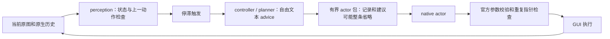

# TaskViews 执行冲突审计：2026-10-12

本审计针对代码 `ff263e8a96c2a0839edacd194b5bb393cc083986`，核查当前 native/feedback 路径、实际原请求和指引。结论是：系统已经有失败记录、后图和停滞触发，但缺少将这些信息转为下一操作依赖的统一契约。规划建议主要是自由文本，执行前主要检查参数和重复操作，因此信息送达后仍可产生相互矛盾的行动。

这里分别标注代码缺口、同一请求里的提示冲突、不同版本之间的指引分歧，以及尚不能由证据确定的原因。计划中的改动未实现，不是新的 OSWorld 成绩或线上改进证明。

**现场与证据边界。** 本次只读实采中，正式 V12 episode 为 `checkpoint_paused`，unit inactive、MainPID/ControlPID=0，同一 VM 保留，最近三个可用检查点的元数据通过，LATEST 所有当前可写盘的物理 tags 通过。累计230 decisions、232真实回执，安全检查点仍为229/231，原官方评分未启动、score=NULL。不同计数属于原运行和安全提交边界，不能把229称为230。

当前 `ff263e8` 的613项回归/Ruff0 proof 已与实际 `project_snapshot()` 精确比较；正式 manifest 的源码仍为 `56740df`，新修复尚未提交为线上续跑方案。本次没有调用模型、操作 GUI、评分、reset 或 resume。此前冻结记录明确原230已执行、230完整检查点未提交；直接恢复229会重放已完成操作，不能用本设计绕过 no-replay 约束。

本次新只读证据：[audit evidence](../outputs/taskviews-mini-design-audit-evidence-20261012.json)，SHA256 `2a52d2dd25fede972d3d2ca6e8ee4853e35945feae386e3aaae6d15d29f9c9e7`；scope `run-rab5614f91c584413bbeff82aae8b1b31`，invocation `7d47d157b28d43a4a0a6802aeec52679`，exit0。它核验选定原请求/动作/反馈和保存后图SHA，不扩展成未经独立核验的全部 frame/compiler/API/SQL 链。

**先看真实循环。**

| 原步骤 | 实际读到的信息与行动 | 可以得出的结论 |
| --- | --- | --- |
| 97、168（历史原件） | 提交 Image 路线后，保存后图明确出现 `Unknown command : Image` | 存在该路线的应用拒绝证据，关闭弹窗不撤销这条历史 |
| 194（历史原件） | 文件对话框提交后出现 `Opening file failed` | 提交失败；这句错误不能唯一证明具体路径不存在 |
| 228 | planner 的真实 request 只包含194的 `Opening file failed`，`omitted_records=7`；advice 同时要求“点击取得焦点，然后 Enter” | 此次 planner 没有读到97错误；不能声称它在已读到97的情况下故意忽略。检索缺口和多操作建议均真实存在 |
| 229 | 上一点击的 focus check 为 unknown；actor 原文说点击没有建立焦点，随后仍发 native Return | 缺少依赖约束。合法按键并不表示适合当前焦点状态 |
| 230 | actor 再换点击参数；保存后图仍为空 Algebra/grid，旧输入文字保留 | 没有图片、点或体积对象的可见进展；参数变化不是目标控件重定位的证明 |

第228步历史简报不是整个字段缺失；它实际送达了另一条错误。系统持久记忆知道一件事，不代表当前 planner/actor 请求知道这件事。单纯增加历史保留条数解决不了相关性选择问题。

**当前调用链为什么允许这件事。**

关键缺口在 P→V→A→G：没有一个统一的 plan_id、target、requires、evidence_refs、expected_result 将建议、现时事实和候选动作绑定。不能把结构合法、报告已存储或包已送达当作这些绑定已经存在。

**冲突与缺口清单。**

| ID / 优先级 | 代码或指引位置 | 已核查的冲突、边界与影响 | 建议 |
| --- | --- | --- | --- |
| C01 / P0 | `taskviews_feedback.py:332–396,690–696` | `validate_planner_report` 检查字段、字节数、原任务引用和数学来源；没有失败记录参数，不检查 advice 与已知失败的关系，也不验证“只下一操作” | 事件 planner 改为短操作意图契约；相同失败路线若没有新的相关证据，必须给出可校验的重试依据。拒绝与原记录矛盾的候选，不硬编码 Image 或替代操作 |
| C02 / P0 | `kimi_taskviews_native.py:79–86`; `pointer_grounding.py:23–61` | 执行前检查 native 参数和重复 pointer/key；没有目标控件的当前焦点、文本已输入或提交对象的依赖检查。keyboard recovery 时 Return 也属于允许的 key 类型 | 对明确的 dependent type/submit 建立目标级 requires；unknown 不变为失败，但不能当成满足依赖。Return 必须区分提交、dismiss 和普通导航 |
| C03 / P0 | `execution_modules.py:342–350`; `taskviews_feedback.py:703–716,732–734` | `needed_evidence` 被累计保存；actor 的 next_strategy 仅含 advice/goal/frame/ref，module 详情又被省略。缺少将 needed_evidence 转为后续观察/执行门槛的消费逻辑 | 将必要证据编译为最小 requires；非必要资料才是可选说明。若需要的事实缺失，计划应为获取该事实的一步操作 |
| C04 / P0 | `execution_modules.py:811–858,969–995`; `taskviews_feedback.py:447–464` | 历史按最近优先、submission/object优先装包，不按当前将采用的路线检索；整条900/1600byte容量下可能保留较新的另一类错误，却省略当前路线的关键拒绝 | 先按目标/操作意图/实际输入和上下文检索，再按事件序排列。失败上下文丢失时不得声称建议已完成一致性检查；保留显式缺口 |
| C05 / P0 | `task_control.py:26–38,40–57`; `taskviews_feedback.py:91–102,124–134,167–176,600–612,668,695` | 同一 system prompt 拼接了多个 exact 输出声明：perception 的3字段与5字段+可选review，controller 的stage/needs与subgoal要求，planner 的exact2字段与可选goal/math。这是当前请求内冲突，不只是旧文档 | 每个 profile/role 只生成一份完整 schema、一个 exact 输出声明；从同一契约生成 prompt 和 validator，避免追加互相覆盖的说明 |
| C06 / P0 | `taskviews_feedback.py:195–204,713–716`; `kimi_native.py:28–43,177–179` | 指引要求单个即时操作，advice仍可表达“点击→Enter”；native 官方能力允许批次，而追加策略没有条件依赖表达。批次能力本身有效，不应一律禁用 | 焦点/页面/目录未知时拆成依赖边界；已知独立操作保留原生批次。批次内尚未取得的焦点不能作为后续输入的已满足事实 |
| C07 / P1 | `execution_modules.py:391–411,694–701,905–967` | 三击已在stall集合和连续review集合内，但 expected_change 的点击集合仍只含left/right/double。三击默认state，后续返回页focus review却要求focus check | 建立覆盖完整声明 action enum 的显式检查契约表。区分原生参数完全相等的 guard 与同目标意图的规划review，不改原动作或生成参数alias |
| C08 / P1 | `execution_modules.py:432–455,775–809,860–903` | 状态字段和表示由模型自由生成，比较以JSON字面值不同为changed；任意changed_field_keys可清除整个停滞窗口。ff263修复了“未给reader的before字段也用于比较”，没有解决同义描述漂移或无关控件变化 | 少量稳定状态类型；把“当前事实成立”和“这次动作导致变化”分开。仅相关目标效果/依赖变化清除对应循环，不因任意界面变化清除全部 |
| C09 / P1 | `execution_modules.py:391–410`; `taskviews_feedback.py:185–193` | 代码把单个Return/Enter泛化为submission并关联最近type；提示又要求Return可能只是关闭对话框。检查层知道歧义，但初始expected_change仍偏向提交/创建对象 | 用本次意图和前台dialog上下文声明操作类型；没有依据保持unknown。提交成功与对象生成分别验证，dismiss不要求对象出现 |
| C10 / P1 | `taskviews_feedback.py:712–716,735–736`; `execution_modules.py:997–1008`; `actor_context.py:139–160` | fresh advice只在触发帧送达，可选上下文不进入actor历史；review marker在规划/准入成功后保存。没有plan_id与actual_action关联，无法判断建议是未采用、已尝试还是被后图推翻 | 保留小型计划生命周期：proposed→selected/declined→attempted→outcome；送达不等于采用。只有处理结果才解除相应策略pending，仍保留有界review频率 |
| C11 / profile差异 | `README.md`共同契约；`docs/cua-v7.md:40–44`; `kimi_taskviews_native.py:65–71`; `actor_context.py:178–189` | v7说明分析失败或可选包缺失不阻止actor；V12 checkpoint_reads则暂停。这是版本策略分歧，不能直接把当前严格暂停视为偶然bug | 明确 `legacy_optional` / `mini_fixed` / `full_checkpoint` 的错误政策。当前V12不得静默降级；未来mini可让纯可选检索失败省略，而完整性、帧/动作/回执/CP异常仍暂停 |
| C12 / profile差异 | `docs/cua-v7.md:15,23`; `kimi_taskviews_native.py:47–54,79–86` | 旧三臂声称actor输入和候选策略一致；当前TaskViews加入mandatory pointer workflow和额外策略guard。predict继承关系相同不代表行为变量相同 | 比较报告列出实际额外prompt、guards和预算，分离“固定views效果”与“新执行控制效果”的消融 |
| C13 / 指引维护 | `README.md`v7示例，`configs/cua-v5-absolute.json`；`taskviews-checkpoint-recovery.md`v8；`osworld_native_experiment.py:279–285` | 默认示例500历史/20图/120k文本/32kviews，当前V12是20历史/1图/32k文本/8kviews；旧v8说明60min/Kimi，最新人类曾要求30min/Qwen。这些不是当前实际manifest参数 | 不回写封存proof/旧计划；新增当前profile入口与明确版本矩阵。计划自身的巡检配置不能冒充当前调度器状态；本次旧automation.toml路径不存在，未据此重建定时任务 |
| C14 / 恢复边界 | 实际原230链与safe229；`prepared-provided-state-comparison-repair/repair.json` | 完整GUI回执与checkpoint原子提交是两种提交；当前不能恢复229并同时声称不重放230 | mini从第一版就保留dispatch/result/consistent-checkpoint的明确状态；只对已完整冻结的边界恢复，未解决分叉保留现场，不能把物理tag当完整actor/graph/SQL检查点 |

C07和C09尤其说明，补齐一个动作在某处的集合，并不等于它在生成预期、效果验证、循环分组和候选准入四处已经一致。继续逐处追加例外会扩大维护成本，应把同一个动作契约作为这些层的共同输入。

表中的代码路径分别属于`ui_kobe/osworld/`，唯`execution_modules.py`属于`kobe_views/`。这些行号对应本审计的ff263基线，后续实现不能把历史行号当成未来代码定位。

**已有代码优化解决了哪些异常。**

以下是已经提交的优化类别，区别于上表仍待实施的架构调整；不是将所有历史修复宣称为当前线上生效。

| 已提交优化 / 代表commit | 对应的真实异常 | 尚未解决的任务层问题 |
| --- | --- | --- |
| 局部actor闭环与事件规划，`b056f53` | 完整分类、模块和长角色报告竞争actor输入；单次未确认就触发全局重规划 | actor有当前图、短建议和操作记录，仍不保证采纳建议或命中目标控件 |
| 精确schema/身份/引用纠错，`e2984e9`、`e9caca8`、`d8ef88b` | 完整provider响应之后，输出envelope、旧claim身份、原任务quote不合法；泛化反馈导致原两次模型修复重复错误 | 修复的是候选结构和来源；没有补齐计划与失败路线、焦点依赖的一致性验证 |
| 失败经验和真实顺序保留，`063e4e9`、`9b8e13c`、`2ad1b2d`、`ab0eeea` | JSON对象排序破坏effects淘汰顺序；64近期缓存/同module报告窗口丢失早期错误；短包只保留最早错误而丢失新失败 | 已有长期记录与最新优先，但“最新”不等于“与当前路线最相关”；228请求正是该缺口 |
| 严格输入准入、精确引用共享和修复请求再准入，`20c2b8c`、`2dd92db`、`a5b47bc`、`52f57ad`、`42fae34` | 多个分析请求完成后本地包floor超限；路径/图/回执重复；完整坏assistant/tool反馈加入历史后，修复请求丢包或超过32k文本 | 保护原件和预算，使请求可合法送出；没有证明送出的建议正确或导图产物出现 |
| 原意图验证、跨参数/点击次数/返回窗口停滞检查，`5d1abbe`、`d92cd03`、`0d1ce51`、`56740df` | 把普通UI变化当成最大化等目标完成；不断换坐标或click count逃过exact重复；窗口回来清掉同目的失败 | 现在能触发部分review并拒绝部分重复参数，但Return仍可在未知焦点时通过；相关效果与无关变化仍未统一 |
| reader实收状态范围比较，当前`ff263e8` | reader没有收到的before字段也被用于变化比较，产生不可靠的state comparison | 当前613proof已精确匹配源码；这项补丁尚未用于正式续跑，且不解决自由文本状态漂移或输入依赖门槛 |

这些优化主要提高工程可运行性、原件保留和反馈可信度。最近核验的230保存后图仍无image/points/volume/save，原官方result=NULL；不能用613回归或修复数量估算完成比例。当前至少还缺导图、有效采点/计算、保存、原生结束、原评分与最终清理，恢复边界分叉也尚未解决。

**为什么比UI-KOBE-like暴露更多意外。**

原因不只是“多获得了几份视图”。完整版增加了多个模型输出协议、持久语义身份、自由状态比较、子目标生命周期、历史检索、有限包内竞争和全状态恢复。每个模块单独合法，组合后仍可能不一致：字段在一层可选、另一层必需；原失败在磁盘上却不在当前请求中；建议已送达却没有采用状态；完整动作已回执却尚未形成可恢复CP。

大量已有测试覆盖了格式、预算和人为fixture，但不会证明真实模型会稳定生成相同状态词、遵守所有拼接规则、将历史错误用于下一计划，或在长轨迹恢复后保持正确检索。这个证据缺口应通过小主干和原轨迹回放缩小，不能由继续累加单模块测试数补齐。旧Kimi和当前Qwen又不同provider，不能把模型差异与架构复杂度的效果混成一个因果结论。

还应分类计数：`Unknown command`/鼠标没命中是应用或执行策略失败；完整API后的schema/identity拒绝是语义候选拒绝；缓存顺序、漏包和缺依赖是系统代码缺口；transport断连是上游故障；诊断helper自己的exit1另记辅助失败。它们都影响耗时，但不能统称为OSWorld或模型API故障。

**借鉴 UI-KOBE 与已有 CUA 时需要区分什么。**

本仓库已完成的 Kimi UI-KOBE-like Task059 原官方0.2、42决策、77commands，0 adviser；Task046为1.0、441决策。实际 native 路径是 `KimiTransitionNativeAgent`→共同`KimiNativeAgent.predict`，`TransitionContext`按真实事件seq取最近最多8边，越界整边省略，没有角色LLM/语义实体身份/自适应needs流程。应把这条已完成路径作为mini起点，而不是把完整版的所有开关关掉后仍继承全部副作用。

原移动端 UI-KOBE v2 本身并非一请求系统：identify→record→decide→execute多个阶段；它的有用原则是当前节点+一跳邻居+记忆、明确的本地instruction、由执行模型在当前原图定位、下一轮重新观察。原代码还读取Android输入法状态作为focus hint；不能将ADB或Android焦点规则直接移植到仅截图的OSWorld desktop任务。[UI-KOBE upstream](https://github.com/YuxiangChai/UI-KOBE)、本地`aitk_files/ui_kobe_v2.py:7–23,1276–1307,1388–1427`，`ui_kobe/utils/vlm_utils.py:343–357`。

Anthropic的参考CUA实现以模型调用→按tool ID返回工具结果→继续观察的loop为核心，也支持顺序批次；这不证明本项目模型一定能完成任务。借鉴的是闭环与明确结果绑定，不复制其模型、工具版本、重试次数或坐标缩放策略。[官方 computer-use loop](https://platform.claude.com/docs/en/agents-and-tools/tool-use/computer-use-tool#how-computer-use-works)、[reference loop](https://github.com/anthropics/claude-quickstarts/blob/main/computer-use-demo/computer_use_demo/loop.py)。

当前Qwen与旧Kimi不是同provider受控比较。上述成功结果证明那次路径可运行，不证明mini/Qwen会重现分数，也不证明自适应views一定降低成功率。

**运行控制应如何统一。**

1. 将原始native动作、现时事实、动作效果、任务产物、官方成绩分别表示。当前focus已经成立，不要求刚才的重复点击一定造成变化；反过来，一次窗口变化也不能证明目标Input取得焦点。
2. 计划声明一个目标级操作意图与requires。当前未知焦点只能支持获取焦点/观察的计划，不能支持依赖该焦点的输入计划；没有typed contract时不通过猜Return用途补齐。
3. 失败索引同时按原事件seq和当前route检索。相同GUI意图/输入路线的历史拒绝优先于无关新错误；原检查及其source/frame/SHA不改，省略必须可见。
4. 冲突检查基于结构化record与相关证据，不使用错误词黑名单或自由文本关键词“纠正”动作。同route重试须指向新的相关证据；genericopen错误不生成具体原因事实。
5. 计划建议是proposal，现时状态也是proposal；执行前策略检查保留这些不确定性。不得宣称结构validator独立证明截图语义为真。未确认依赖不强制结束episode，也不自动生成GUI动作。
6. 将完整审计引用与模型短上下文分离。模型只需要当前相关事实和操作记录；长物理路径、图关系和历史全量留在原事件库。不删除原assistant/tool ID或当前共享历史。
7. 对不确定依赖的一步执行→新图→下一依赖进行强绑定；对已知独立操作保留批次。新planner只在已有事件触发时调用，不为了校验再加一个常驻judge。

**实施顺序。** 先完成一份每profile/role唯一schema与错误政策矩阵，随后做mini M0的确定性固定views与原生闭环；再把最小意图/事实/依赖作为M1加入。这比继续向大段advice中追加规则更可核验。详见[mini主干与叠加计划](taskviews-mini-roadmap-20261012.md)。本次交付为审计和计划，未修改运行实现、未迁移当前episode、未启动mini。
