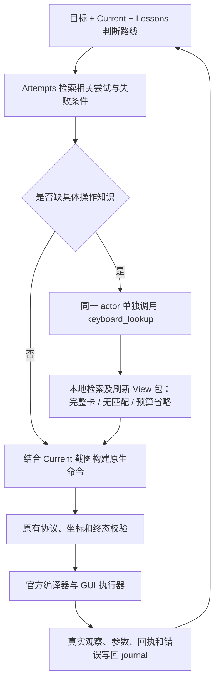

# Source-linked TaskViews 五阶段流程 v9

本轮基于 `3800520` 的 Graph 开发路径，保留其后的文档提交和上一轮可选 Keyboard 改动，没有切换到历史 Mini v3。新策略是 `capability_guidance_v9`，流程契约为 `source_linked_five_stage_v1`；历史 Mini v7、指导模块 v7 和本版本号是不同概念。

## 运行方式

四个 View 仍交给同一个 CUA actor。五阶段是信息使用顺序，不是五个模型角色，也不要求每轮输出五段推理。



| 阶段 | 本次接入 | 证据边界 |
|---|---|---|
| 路线判断 | 公共提示先使用目标、Current 截图及 Lessons；本轮查询留下简短策略来源 | 不采集隐藏推理；模型结论不升级为事实 |
| 尝试复用 | 在原有 96 条事件窗口中，以公开操作需求的动作及非泛化对象词检索一条相关尝试 | 同任务、有效期、真实派发和观察来源校验；错误仍是错误，旧坐标重新定位 |
| 知识补充 | 请求前可选预取仍保留；本轮策略可以通过 `keyboard_lookup` 请求缺失绑定或流程，并覆盖预取 | 预取不是当前路线；无匹配可直接行动，不启用未冻结能力或猜测快捷键 |
| 命令构建 | 查询完成后同一 actor 使用同一当前截图、更新后的 View 包构建具体命令 | 不自动把配方转换成动作，不要求参数与卡一致 |
| 执行反馈 | 只将最终合法 `computer_use` 交给原编译器；真实结果进入原 journal 和四个 View | 查询不是 GUI 尝试；回执不证明效果或成功 |

代码能够约束检索、来源、预算和派发先后；不能证明模型在内部严格按五步思考，也不能仅凭收到卡证明采用建议。

## 可选的本轮知识查询

模型只在缺少具体操作知识时调用：

```json
{
  "intent": "Copy the selected text in the reference panel",
  "missing_knowledge": "The applicable copy binding"
}
```

两字段分别限制 160、120 字符，总计最多 480 UTF-8 bytes；不接受额外字段或 lookup 标签，不要求提交完整思维链。仅 `intent` 参与操作检索，`missing_knowledge` 解释具体缺口；不会读取 `reasoning_content` 进行选卡。

一次 `actor.predict` 最多接受一次查询。查询必须单独成批；混合 `keyboard_lookup` 和点击、输入或结束动作时，整批在派发前拒绝，沿原协议纠错处理。有效查询返回后本轮工具列表移除 `keyboard_lookup`，重复调用也受硬性检查和原有纠错上限约束。

对话顺序是：

```text
原始截图、任务和 View 包
→ assistant: keyboard_lookup(intent, missing_knowledge)
→ tool: query_ref + included / no_match / omitted_budget
→ 同一截图下的更新 View 包
→ assistant: computer_use(...)
→ 原校验、编译与执行
```

完整卡只进入更新后的补充包，**不复制到 tool 回复中**。旧预取包不会和新包一起重复注入后续请求，仍保持 3000 UTF-8 bytes 上限、实际请求余量和来源校验。无匹配、目录／能力覆盖缺口、预算省略均可继续由模型原生决策；`focus.verify` 不会恢复。

请求前预取仍是基于已有任务、公开意图和执行状态的帮助，不可能知道本轮隐藏推理。新工具补上“本轮形成策略后再查”的入口。旧 `<key_lookup>` 标签保留解析兼容，但仍是下一轮生效，当前提示不把它作为即时查询入口。

例如模型已决定从菜单复制文本，但不确定快捷键，可以查询得到 Ctrl+C；也可以继续选择当前可见的右键菜单。若目录未覆盖特殊排版动作，返回 no_match 后直接构建点击或拖拽，不为该动作凑一张通用卡。

## Attempts 与送达优先级

原检索主要依赖导航意图和 again/reopen 等词。本轮增加操作与对象同时匹配的检索，不再要求模型先说“再次”。仅检索有原始 issuing decision、前后观察和完整派发记录的动作；截图和等待不会被当作已执行的业务路径。支持普通中文对象词，不包含任务名称、目标文件或评测答案规则。

失败派发也可被召回，用于展示原错误和失败条件，不能被标成成功路线。召回结果的 `effect_status` 继续为 unknown；其 issuing intention 保留 proposal 身份。

在测试中发现 flat 会出现“检索到了，但排在卡后面因预算未送达”。因此，本轮显式查询召回的尝试在完整操作卡前尝试准入。当前状态、最新执行和真实错误优先级保持。普通预取／旧导航召回仍沿原预算策略，不把整个历史塞入包。所有记录完整准入或明确省略，不截断事实，不以无关卡填补空间。

## 日志、Graph 与恢复

- 原 journal 追加 `knowledge_query` 和 `knowledge_result`，记录公开需求、当前观察、请求／工具 ID、选择状态及包哈希，不新增截图副本，不改写原事件。
- Query 是 `public_strategy_proposal_not_execution`；不会进入 GUI 的决策次数、命令列表或派发次数，不建立成功或因果关系。
- Graph 索引继续按 episode 和原始事件 ID 重建；查询来源可沿 Current 的 strategy 引用和卡片 evidence 回到 journal。没有新增图路径规划或语义因果推断。
- 同一截图可以先发送预取包，再发送查询更新包，因此指导审计使用 episode、frame、context_revision 区分。保留 `decision_frames`、`context_revisions` 和真实请求回执数量，不混为决策次数。
- `decision_flow` 审计分别记录召回来源、实际入包来源、预算省略，以及指导匹配／送达。模型使用情况仍是 unknown。
- 查询对话作为本次推理的临时、完整工具往返；请求原件与查询事件保留审计。后续原生历史只保留最终 GUI 决策及对应执行回执，不留下孤立查询工具 ID。下一步不继续激活旧查询。
- v9 流程及预算策略进入冻结配置和 checkpoint。不能用新代码静默恢复 v8／v7 运行；新实验须重新准备计划，历史实验继续使用冻结源码。

## 调用与预算

不查询时，正常决策仍只有一次 actor 请求。查询时增加一次同 actor API 往返，不增加 actor.predict 次数，不引入额外规划角色。它与最终动作和复核纠错**共用原 deadline、输出 tokens 账本和两次纠错限制**，不能重置时间或获得新的 token 池。

在两次纠错配置下，每次 predict 最多是：原始请求 + 一次有效知识往返 + 两次纠错请求。没有有效查询时维持原来的请求上限。实际费用、输入／输出 tokens 和耗时必须包含查询；不能仅比较最终回复的 usage。原 `step_tokens.known_usage` 已累计同一步的真实请求用量，新增 trace 单列 `knowledge_roundtrips` 与 `api_attempts`。

## 验证与使用范围

应用于最新 `task_capabilities` 指导路径的 legacy、flat、linked；旧 task_names/manual 和 baseline 的原生提示、工具及编译行为保持。三种图模式的同输入预算一致性继续验证，linked 仍没有完整图检索或路径规划。

离线验证产物位于 `outputs/five-stage-flow-v9-20261030/`。覆盖直接行动、匹配／无匹配、冻结能力缺口、预算极小、多字节需求、混合批次拒绝、重复查询上限、查询后终态两次纠错、实际 token 账本、失败路径召回、查询过期、Graph 来源和恢复隔离、flat/linked 同输入准入，以及历史日志回放。验证不会启动 guest、真实模型 API 或官方评分。

主要实现：`kobe_views/decision_flow.py`、`ui_kobe/osworld/mini_keyboard_lookup.py`、`mini_recovery.py`、`mini_taskviews_context.py`、`guidance_delivery.py`。这建立了可运行的交互路径，是否提高成功率或减少总 tokens，仍需后续受控在线评测。
