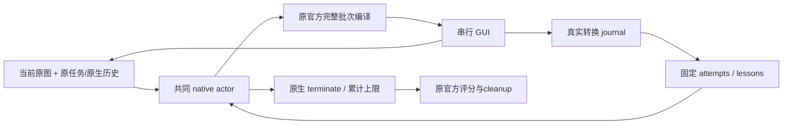

# TaskViews Mini：UI-KOBE-like 主干与逐层接入计划

目标是先证明少量固定TaskViews能够在共同native CUA上完成真实OSWorld流程，再逐层加入完整版能力。第一版以本仓库已完成的UI-KOBE-like路径为起点，原模型、原图、native history、工具ID、官方compiler/controller、累计步数、官方评分和资源保护保持明确边界。**本文件是待实施计划；没有创建新任务、VM、API请求或正式episode。**

审计基线是`ff263e8`；证据和冲突清单见[系统审计](taskviews-conflict-audit-20261012.md)。当前V12暂停且原230超出safe229，不能把mini作为修复直接装入该旧episode，不能丢弃旧模块后声称同策略续跑。

**M0 最小主干。**

M0保留一个native actor，将TaskViews定义为已有观察与转换记录的三个固定读取投影。没有perception/controller/planner/verifier的额外模型请求，没有由模型创建entity/claim ID、动态图needs、子目标DAG或stage完结判断。actor直接读取当前原图和原任务，由它选择native动作和原生结束；低层执行与反馈共用已完成路径。

这是真正的多个可读视图：每个视图有固定selector、数据来源、字节额度、frame/episode绑定和送达标记；不是把一个巨大包改名为三个views。固定view IDs是代码声明的接口标识，不重命名任何原native tool/operation ID。

| 固定view | 获取方式 | 首版内容与界限 |
| --- | --- | --- |
| `current` | 当前官方frame + 原任务/保留历史 | 复用actor本来就收到的原图，附固定view声明和frame绑定；不复制图片或完整原任务，不生成bbox/数学结论 |
| `attempts` | 原execution journal的event.seq最近边查询，参考`TransitionContext` | 原参数、实际工具/回执错误、前后观察ID、短证据引用；最多4个完整投影，逆序选取后按原顺序呈现，超限整条省略 |
| `lessons` | 真实protocol/controller错误与有明确来源的已记录应用反馈查询 | 原native IDs、原literal quote/原记录来源，标明transport与视觉proposal的区别；M0没有独立视觉提取器，若新episode只有原actor prose就只送该原prose作为历史proposal，不自动把它解析成已验证应用错误 |

`lessons`为空是合法状态。不能为填满第三个view启动perception、从隐藏评分读取错误、用字符串规则把“没看到”升级为失败，或把旧成功轨迹/坐标/公式放入新episode。稳定的视觉失败类别在M1的有界同调用观察侧记录中建立。

M0固定文本包目标上限3000 UTF-8 bytes，且实际准入仍取当前共同上下文剩余量；这是初始设计容量，不是增加现有8KB或32k输入上限。`attempts`与`lessons`先各有小额度，再在同一可选包内利用剩余容量；每个view报告完整记录省略数。模型使用的短source ID在journal中可回溯完整不可变原件，磁盘路径和大图报告留审计；不生成可执行的action alias或外来坐标。

正常M0每次predict只有原actor请求；原transport重试/actor语义修复另计，不能保证“一决策恰好一HTTP”。已有current image/history预算不因views缩小。纯可选投影格式/大小不可用时明确省略；任务/官方素材、native身份、帧、真实回执、journal完整性或checkpoint异常依旧严格暂停。M0的可选policy不得偷偷替换当前V12 full_checkpoint policy。



**首版代码边界与实现任务。**

| 待实现位置 | 具体职责 | 避免带入的完整版依赖 |
| --- | --- | --- |
| `ui_kobe/osworld/qwen_native_base.py`（拟） | 机械提取当前Qwen provider profile/transport/generation_fields，供native UI-KOBE-like和mini共享；不改协议、URL、model或cap | 不通过继承`QwenTaskViewsNativeAgent`获取provider而顺带初始化全部control/modules |
| `ui_kobe/osworld/mini_taskviews_native.py`（拟） | 复用共同`KimiNativeAgent.predict/generate_candidate`及Qwen provider；只提供fixed context/reset/trace接入 | 不复制predict、不隐式开启feedback_v10的角色链和pointer guards |
| `ui_kobe/osworld/mini_taskviews_context.py`（拟） | 三个固定selectors、整体准入与实际送达回调；复用journal查询/边引用 | 不调用`build_feedback_views`、`DynamicViewController`、`TaskMemory`语义抽取或全量module projection |
| `kobe_views/fixed_views.py`（拟） | 简单只读view声明、选择与materialized envelope，frame/source/whole omission契约 | 不创建虚拟语义事实，不与原历史混写，不另建复杂事件账本 |
| 准备/runner入口及配置（拟） | 显式`taskviews_profile=mini_fixed_v1`，冻结唯一policy/schema/错误等级；选择原公共actor路径 | 当前qwen-native仅有taskviews arm，需先增加受控UI-KOBE-like/mini选择，不能把旧Kimi成绩当Qwen对照 |

M0检查点集成也需要显式适配：现有恢复器保存并重建full TaskViews graph/modules，不能假设仅继承native actor就支持原完整CP。mini需保存原actor历史、native IDs/待回执状态、journal备份、fixed-view版本与送达游标，仍与guestRAM/全部可写盘一起原子提交。纯view无需另建虚拟图。远端网站副作用不能由本地VM快照回滚；外部任务恢复需单独设计，当前Task059能力不冒充通用rollback。

实现分三次本地提交：第一步只提取provider、确认UI-KOBE-like请求路径等价；第二步增加fixed projector与mini adapter；第三步增加冻结profile和明确checkpoint capability。每次实际源码改动都先有界验证/Ruff、新proof、commit、Gitclean。预计工作量不是完成时间承诺；第一步和第二步无需真实API即可验证接口。

**M1 补齐实际执行依赖，保持一个写GUI的actor。**

M0先验证固定views主干。M1再针对审计中的focus/submit循环加入最小`ActionIntent`/当前事实侧记录，可由同一actor调用的短文本侧记录产生，或消费同一帧已有可靠来源；不增加常驻planner/perception API。侧记录不是新GUI tool，不改native参数/工具ID，也不是独立真值。

```text
intent: {intent_id, frame_id, target_label, operation_kind,
         requires:[fact_id], expected_result, evidence_refs:[source_id]}
fact:   {fact_id, frame_id, target_label, status:observed|unknown|absent,
         source_id, grade:model_proposal}
```

`operation_kind`要区分focus、type、submit、dismiss、navigation等意义。不能仅因native Return推断submit。一个Input当前可见焦点事实与上一点击是否造成焦点变化是不同概念：前者可支持依赖操作，后者用于反馈和停滞分析。鼠标动作、窗口回来或工具returned本身不生成focus事实；旧frame/别的control事实不满足requires。

在明确的M1严格依赖profile中，dependent type/submit缺少目标级当前事实时，保留原候选并在原actor修复池中给出未满足依赖，模型自己生成获取证据/焦点的新合法候选。不会自动插入点击、指定坐标、猜快捷键或执行合法批次的前缀。对于当前dialog的dismiss，不能错误套用Input submit依赖。焦点不可从截图确定时保持unknown，允许普通观察/导航/提问，不能强制结束或无限本地修复。

先以shadow模式记录该检查对真实候选的判断，再开启决策gate。无侧记录的M0不会被错误地当成M1缺失必需字段；M1开启后则不能静默忽略必需侧记录。M0与M1是两份显式profile，不把两套政策拼接在一条prompt里。

**事件planner的后续接口。**

当固定主干和M1已验证，再允许在已有停滞/明确应用拒绝/子目标变化事件上调用一个可选planner。它输出一个短意图，不输出native坐标：

```text
proposal: {plan_id, frame_id, target_label, next_operation_kind,
           requires:[fact_id], expected_result, failed_attempt_refs:[operation_id],
           retry_evidence:[source_id]}
```

source IDs只指向本请求实际提供的原件；缺失视图不能通过口头“检查过历史”补齐。同路线曾被明确应用拒绝且相关上下文未变时，新候选必须给出相关新证据。unknown只是缺证，不能创建一条确定失败禁令。系统不使用`Image`/特定error字符串黑名单，也不替actor选择菜单或路径。

候选使用现有原两次修复边界，不增加API探针或额外judge。planner依据不足时应提出获取依据的一步，而不是构造一个宣称requires已满足的动作。短契约与提供的事实可机械检查；语义相关性仍可能判断错误，需要同帧后图核验，不能宣称validator证明真实UI状态。

计划保存很小的生命周期`proposed→selected/declined→attempted→outcome`。actor允许有理由地拒绝建议；实际native动作与intent_id关联。送达游标、review冷却、计划完成分别记录；发送一次新建议不解除未确认依赖，不因窗口切换/无关字段变化清空失败路线。

**完整版各模块怎样叠加。**

| 层次 | 接入内容 | 接入方式与验收条件 |
| --- | --- | --- |
| M0 | 固定3views、真实边、共同native actor | 正常额外角色请求0；空views等价路径与整包省略不破坏原任务/history；先得到正式Task059完整流程和原score≥0.2 |
| M1 | 当前事实、动作意图、依赖门槛、失败相关性检索 | 同调用短侧记录先shadow后gate；228→229类型错误、Return dismiss、已知focus的幂等操作、未知/过时/异control证据均正确区分 |
| L2 | 单个事件planner、策略生命周期 | 只在事件上调用，保留原分析预算；同route重试解释、候选采用/拒绝、后图结果可追溯；不重新变成每帧全局规划 |
| L3 | 稳定小型subgoal DAG、产物依赖 | 原任务来源/稳定ID/阶段产物分开；先在旁路记录，观察到产物才支持状态推进，proposal和评分分离；不让stage变化切掉相关失败 |
| L4 | 被动语义图/TaskMemory、长期失败索引 | journal仍是事实原件；图做可丢弃投影，先离线或同进程旁路验证，不另开并行API/VM。实体/claim抽取按事件开启，schema失败不会污染现时facts |
| L5 | 固定角色读权限与更丰富views | 用已知实体/关系的固定selectors先接入；同一个事实/失败版本提供给planner与actor，限制不同角色投影造成信息矛盾；读权限与GUI写权限分离 |
| L6 | 自适应DynamicViewController、needs/anchors、view delta | 从规则选择升级为模型选择；先只提议，失败回到当前已验证固定views profile。引入前完成预算floor、遗漏、frame绑定与送达游标验证 |
| L7 | 数学来源检查、独立verifier、compensation/recovery扩展 | 有明确任务收益才按事件调用。数学只能来自当前literal application_math/原要求正确类别，不能用像素角点推答案；模型verifier不评分、不自动完成或回滚 |

这里的“旁路”指记录/离线回放或同一进程串行计算，不是运行并行模型请求。生命周期/资源保护/真实API账本/官方资产核验/完整可恢复CP是主干基础，不应等到L7才补。L7扩展的是语义恢复和跨系统补偿权限。

每层单独feature flag和新冻结profile，默认关闭；先证明不会改变M0关闭该层时的行为，再证明对真实任务产物有益。core transport/geometry/journal/CP错误为hard pause；可选view或可选planner的不可用为显式soft omission；作为已声明requires的事实缺失则阻止对应dependent候选。三种状态不能只用一个宽泛except转成同一种故障。

**具体测试与运行准入。**

| 验证 | 需要证明什么 |
| --- | --- |
| 原228/229/230纯回放 | 新候选不能以未知焦点支持提交；完整保留原工具ID/原失败/后图来源。单纯换坐标或click count不作为修复成功 |
| 错误相关性 | 当前Image路线需要的原应用拒绝不再只因更旧而被无关opening错误挤出；若仍被省略，一致性检查结果明确unknown |
| 单一schema契约 | 每profile/role唯一输出形状，prompt与validator一致；不同时出现冲突exact声明；未知/absence/不适用分开 |
| 动作依赖与批次 | 未确认focus→type/submit拒绝；dialog dismiss Return可合法；已知focus和独立原生批次保留；拒绝整批不执行前缀 |
| 请求与历史 | M0正常0额外角色调用；仍有原transport/semantic retries而不增加上限；原任务、当前图、native IDs、完整错误不被投影改写 |
| 长轨迹/恢复 | 至少500次纯mock记录，真实事件顺序、原已确认失败不被JSON排序破坏、预算无增长；CP保存pending/tool配对与fixed-view版本，安全边界不能重放已完成动作 |
| 正式在线 | 离线mock分数不是OSWorld成绩；未来获授权的独立mini episode必须自然terminate/累计原上限后执行原评估，保存有效产物与original score，cleanup/audit通过 |

未来对照应使用同一个Qwen协议、模型/节点、截图/历史、输出/修复预算与资源策略，比较native UI-KOBE-like、mini固定views，以及每次只新增一层的mini。旧Kimi成功轨迹只作只读设计证据，不提供旧答案/坐标；不能将当前V12做reset来制造这个对照。

核心验收是实际图片导入、合法采点、拟合/计算、原文件保存、原生结束与官方评测。模块数量、生成views数、mock分数或接口回执数量只用于工程诊断，不替代产物。首版正式score≥0.2后即可达成本轮目标，不为追1.0继续增加机制。

**本次交付状态。** 已完成代码/指引/原请求审计和上述实现计划。待实施的是M0三次本地提交与其验证，随后才是M1及后续层；没有宣称mini已运行、已有新成功分数，或当前V12可以安全直接切换到mini。
